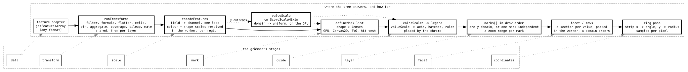

# The mark layer against the grammar of graphics

The grammar of graphics is a pipeline: data, transform, scale, mark, guide,
layer, facet, coordinates. The decisions that built the layer are ADR-095
§"The grammar position", ADR-106 through ADR-119, ADR-150, ADR-153 and ADR-162;
each position below points at the record that holds its measurement.

## Four rules for how far to take it

**1. The parser's output is the data.** The grammar reads each record where the
parser left it (bbi's typed arrays, a BAM record's bytes, vcf-js's variant)
through a reader resolved once per region. The GPU instance buffer is the one new
representation, and any other copy needs a reason the drawing gives. ADR-152
found that every measured refusal to move a display onto the encoder blamed the
per-row feature object, never the rule. The remaining copies are
[copies-between-each-parser-and-its-instance-buffer](../ideas/waiting-on-a-number/copies-between-each-parser-and-its-instance-buffer.md).

**2. One object per concept, and every surface reads it.** Color, the value
scale, the facet and the transform step are one object each (ADR-131, 135, 142,
150, 153): painter, uniforms, legend, axis, menu, dialog, validator, SVG export
and hit test all derive from it. A display that spells one of those concepts its
own way is the finding. The row axis follows it (ADR-165). Text follows it in
typography only: `FloatingText` and `SvgHaloText` are the one emit, and placement
stays each display's (ADR-162). Hi-C reads color through `observed`'s linear or `observed/expected`'s diverging
preset, LD through `r2`'s and `dprime`'s, the field being the statistic the
file serves, and MAF through one preset per field.

**Unity is that rule held over every surface, not fewer display types**
(Colin, 2026-09-30). The menu builders (`colorByMenu.ts` and `groupByMenu.ts`
in display-kit, `rowArrangementMenuItem.ts`, `scoreMenuItems.ts`), Edit plot
(ADR-204), the validator, the legend, the axis, the agent API and SVG export
each read the one object. A display becomes a mark-display subtype only when
its whole picture is a plot, as Manhattan is (ADR-178); alignments, canvas,
Hi-C, MAF (ADR-199) and the comparative displays hold fetch policy, layout
memory and domain actions a plot does not. Their domain actions stay theirs.

**3. Generality resolves before the loop.** A shape composes its scale at
`gen:shaders` (ADR-095), a field name becomes a direct read before the walk, a
domain rides a uniform, and a lane nobody asked for is never allocated. A
declared form must land at 1.00x the hand-written path or better.

The predicate list (ADR-238) fuses flag bits into one mask compare and reads
the record in hand. Against the alignments display's hand-written flag and
MAPQ test alone it measures below, about 2 ns a read, and inside a whole
`1000x.shortread.bam` fetch the two arms read the same, so the alignments read
filter runs the list.

<!-- BEGIN GENERATED MEASUREMENT field-predicate-read-filter -->

_Generated by `pnpm autogen` — edit the source, not this block._

| arm                                                    | hand-written | compiled list | compiled vs hand |
| ------------------------------------------------------ | ------------ | ------------- | ---------------- |
| 2M reads, flags + MAPQ, ada                            | 7ms          | 10.9ms        | 1.56x            |
| 1000x whole fetch, fetch + filter, ada                 | 130.4ms      | 129.5ms       | 0.99x            |
| 1000x whole fetch, filter loop alone, ada              | 4.77ms       | 4.83ms        | 1.01x            |
| 1342 sites, site test alone x100, laptop               | 1.34ms       | 2.11ms        | 1.57x            |
| 1342 sites, allele counts + site test, laptop          | 117.9ms      | 110.2ms       | 0.93x            |
| 200k features, jexl expression entry, laptop           | 55.8ms       | 56ms          | 1.00x            |
| 200k features, the same filter as a field test, laptop | 55.8ms       | 10.4ms        | 0.19x            |

<!-- END GENERATED MEASUREMENT field-predicate-read-filter -->

**4. A track stays its format, and the grammar supplies its parts.** The grammar
converges the parts every display shares, not the displays (ADR-091). A new mark
or channel arrives when it retires a hand-written spelling somewhere.
`MultiQuantitativeTrack`, `GWASTrack` and `GCContentTrack` are role bundles (a
guesser name carrying which display leads and its `displayDefaults`); the rule
refuses a channel hidden inside a track type, which a bundle of defaults does not
carry.

**Color stays each mark's.** Scale members on each mark's `encoding.color` are
Vega-Lite's own spelling, and a display-level `scales.color` would be a second
spelling. Plasma and turbo are not among the named ramps (plasma reads as
magma's sibling, turbo is not perceptually uniform). On HicColor and LDColor
an unset `reverse` turns round the four sequential ramps dark at their low end,
viridis, magma, inferno and cividis (`darkAtLowEnd`, `matrixColorEncodingOf`),
since such a ramp paints every sparse cell a dark speck. The list is named, not
measured: a luminance test also reversed every diverging ramp, whose light color
is its middle.

## Seams

- **A color or shape scale is declared on its channel; the value scale is the
  plot's** (ADR-141, ADR-142, narrowing
  [ADR-113](../architecture-decision-records/adr-113-one-scale-rule-in-one-place.md)).
  A categorical color is data and travels packed with the instance, while a
  domain that moves on every autoscale must not touch a buffer
  ([ADR-097](../architecture-decision-records/adr-097-the-y-channel-shares-its-scale-and-not-its-anchor.md)).
- **Two channel vocabularies remain.** The encoding says `x`, `x2`, `y`, `row`,
  `color`, `shape`; variants' cell and canvas's rect say `startEnd`. ADR-106
  §Consequences parked converging them, because that array is the worker payload
  many modules address by `2i`. Canvas's `y`/`height` are pixel geometry, so
  renaming them converges nothing.

## The facet stage

**A `sort` orders and never decides which sections exist**, so no worker request
carries one and a reorder refetches nothing. Every `rows.sort` (`rowSort`,
ADR-157), the multiway lanes' included, every `facet.sort` and the legend order
are that one rule (`groupKeyComparator`). Past the `sort` list, values found on
features follow sorted, since the order they arrive in changes with the region,
while rows a source lists keep its order (`orderRowsByDomain`), since a
phylogeny's leaf order and a file's sample order mean something; where a tree
describes the rows, the `sort` list rotates it (`rotateNewickByDomain`).

A filter is a list of Vega-Lite field predicates (`{ field, gte | oneOf |
valid ... }`), each compiled to a typed read and a compare before the loop;
jexl stays the slow path, a computed `field` or the mark display's `filter`
step
([ADR-238](../architecture-decision-records/adr-238-every-display-speaks-vega-lite.md),
which reverses the decline of `{ field, oneOf }` this paragraph held).

Declined on 2026-09-30: track- or view-level facets, and a free y per section.

## Gaps against the grammar

- **`stack` is declined, and so is the min-to-max range bar `y2`.** The stacked
  histogram was built and declined on its captures; the mirror (two bars, a
  `formula` negating one) and the rows form draw today. Don't re-propose either.
  A genotype share band over the multi-sample variant display's rows was built
  and removed too
  ([ADR-206](../architecture-decision-records/adr-206-a-row-display-summarizes-its-rows-in-a-frequency-band.md)).
  A weighted depth per bin is declarable with a `bin` over `fields` and a
  weighted `aggregate`
  ([ADR-197](../architecture-decision-records/adr-197-a-bin-cuts-an-interval-at-its-edges.md)).
- **`fold` is absent.** A frequency per population stored as one INFO field
  per group goes through bcftools to a bigWig per group, drawn as multi-wiggle
  rows (ADR-206).
- **`sample` is absent.** A BigWig's summary tiers are the adapter's
  (ADR-123), and `bin` takes `step: "auto"` (ADR-117). `window` counts its
  `frame` in rows of a group in start order, so its moving average runs over a
  fixed number of sites. Over a BigWig read at a summary tier
  a row is a tier bin, so the frame's reach in bases follows the zoom there.
- **Scale resolution across layers: y never resolves independently.** Every
  drawing mark folds into the display's one y scale, which withdrew
  `resolve: 'independent'` (ADR-141). Two marks with open ramps over one field
  union nothing: the domain is a uniform each mark's shader reads off its own
  loaded values, so sharing it is a rendering change to measure.
- **No conditional encoding.** Hover and selection are a guide over the painting,
  not a `condition` on a channel
  ([ADR-110](../architecture-decision-records/adr-110-a-display-declares-what-is-highlighted.md)):
  an in-shader predicate would make the Canvas2D fallback repaint the whole
  display per mousemove.
- **One channel carries two variables on the quantitative display's rows.**
  With `encoding.color` unset, a row per subtrack paints a bar or line in its
  row color above the cut and in the shared negative color below it
  (`buildSourceRenderData`), so signed data still reads as signed. No color
  object states it: the hue is the row's and the side is the value's. A
  heatmap does not do it, since a gradient there paints every row alike
  (WIGGLE_DISPLAY.md), and ADR-227 keeps it as a reason the plots stay off
  render-core's one-field color.
- **No per-layer data on the mark display, and no `lookup` join.** No measurement
  backs it, and each source multiplies the refName renaming, byte gate and zoom
  range a display runs once today. It reopens when a named plot needs two files
  in one display. The multi-way display's lanes already read a source per layer
  (ADR-180): the row facet's value, `{assembly}`, picks each lane's track.
  ADR-245 declines drawing one track's rows on another's transcripts.
- **Fewer channels.** `opacity` and `angle` are uniforms, not channels, because
  shapes compile from hand-written Slang (ADR-095); `opacity` also breaks the
  Canvas2D painters' color batching. The alignments quality fade is
  `pileup.mismatches.encoding.opacity` over `baseQuality` (ADR-240), whose
  linear scale folds into four uniforms of mismatch.slang;
  `pileup.fadeLowFrequency` stays a boolean, since depth and zoom set its
  ramp. `encoding.size` maps a width through the
  `size` lane on the link alone
  ([ADR-163](../architecture-decision-records/adr-163-a-link-is-a-mark-and-the-arc-plugin-is-gone.md)).
  An area mark waits on `y2`; the line is a mark
  ([ADR-184](../architecture-decision-records/adr-184-a-line-is-a-mark.md)).
  No `tooltip` channel either: each display's hover prints its own fields,
  and a plot naming them waits on one whose hover prints the wrong ones.
- **A band is one config object**
  ([ADR-231](../architecture-decision-records/adr-231-an-alignments-band-is-one-config-object.md)).
  The alignments `coverage`, `pileup`, `sashimi` and `readConnections`, and
  MAF's `coverage` and `conservation`, each hold `show`, `height` and
  `placement` meaning the same in every band. `show` toggles a band, a layer
  or part of a mark, or the arcs' context pairs, and nothing else.
- **A predicate lives where what it selects lives**
  ([ADR-232](../architecture-decision-records/adr-232-a-predicate-lives-where-what-it-selects-lives.md)).
  The alignments display's `filter` holds its tests on reads and on the data
  derived from them, the `junction`, `connection` and `breakpoint` fields, and
  every part drawing junctions or connections reads them: the sashimi arcs and the
  tables engine's junctions, and the arcs, the read cloud and the curved
  connectors over the pileup.
- **`encoding.y.rules` draws fixed lines.** A `rule` layer with a constant `y`,
  taking a zoom range and a per-row value, waits on a plot that needs either;
  the CNV figures carry no reference line, since their keys name the level.
- **One checker per display, `configProblemsOf(conf)`, answers both Edit plot
  and the corner.** The base runs the schema's own `fieldPresets`
  (`schemaPlotProblems`), the rule `jbrowse validate` runs offline; a display
  adds its rules (wiggle's cut cap, MAF's codon frames, alignments' levels,
  canvas's jexl) and the mark display replaces it with its rule list.
  `plotProblems` asks it of a lifted draft and `notices` of the live config,
  then adds `liveNotices`, the lines only loaded data can say (a facet value no
  read answers, a row banding over a field no row carries). `DisplayChrome`
  draws the chip. A display's own rules stay out of `jbrowse validate`, which
  reads data and not code.
- **No ordinal x**, until a declared plot wants equal-width columns. LD and the
  multi-sample matrix draw one column per variant under one `variantLayout`
  slot;
  [a-distribution-plot-needs-x-to-be-a-value](../ideas/waiting-on-a-call/a-distribution-plot-needs-x-to-be-a-value.md)
  is its value-x sibling.
- **Typed tables cover MAF and BigWig alone** (`getFeatureTable`). BAM/CRAM,
  VCF and bigBed wait on a declared plot over one being slow on real data.
  ADR-114's 3.11x and ADR-118's 4.23x blamed the per-row `Feature` that
  ADR-191 removed for typed sources, so re-measure both before citing them.

## What the 2026-10-07 release audit checked and found agreeing

Five read-only audits ran over the vocabulary, the JSON schema, the mark
pipeline, the plot write paths and the docs before v5.0.0, and their findings
landed as ADR-214 to ADR-220. What they checked and found in order is as much
the result, since it is what a later audit need not redo:

- Every color object carries ADR-151's members, and a written `field` paints
  on each. The audit checked `scale: 'none'`, which ADR-240 has since retired:
  the field a pick leaves is display state (`ParkedColorMixin`). Alignments'
  `pileup.bases.encoding.color` and `readConnections.encoding.color` are the
  exceptions by design: each names a field alone, since each field paints a
  vocabulary of its own (ADR-149), and the arcs borrow `encoding.color`'s
  `scale.range` by category.
- `fieldPresets` names agree across displays: `strand`, `identity`, `mapq`,
  `count`, `r2`, `dprime`.
- Every shorthand has its schema branch, and a `null` reset agrees across the
  write paths on a typed slot.
- Each display's `plotExamples` round-tripped through `plot`, `applyPlot`, a
  session delta and a reload unchanged, 47 examples on 14 displays that day.
- The CLI's copy of the mark rule list is byte-identical to the live one, and
  `pnpm autogen` holds it there.
- SVG export shares the Canvas2D painters, so no mark lacks a twin.
- A new mark, step type, scale kind, color member or display type is additive
  in the JSON schema: its `if/then` dispatch passes a type it does not know.
- `displayDefaults` expand into the display config, so `plot` and "Reset track
  settings" see them.
- Alignments `sort` is not a second spelling of
  `rows.sort`, since pileup rows have no keys; `displayMode`, `data.resolution`
  and `heightMode` are layout or fetch modes, not marks, and MAF's
  `conservation.unit` is what one bar stands for.

The audit left the cookbook's whole-config recipe on a jexl callback, on
purpose: it paints SNVs one color and every other variant another, which a
color object has no member for.

## Where a proposal lands

A new channel or scale kind is the encoder's (`markEncodingTypes.ts`) and needs a
shape, or a layer as the text mark is, that reads it. A new guide is a hook on the
mixin that owns the scale and a placement in the two shells. A transform is a
`type` on `StepSnapshot` and on `TransformStep`, an arm in `runTransforms`, a
member of the `MarkTransform` union and an arm in `stepsOf`, which a test and the
compiler refuse to let disagree (ADR-150). It needs a `marks` config that wants
it, not a display whose code it resembles (ADR-118). A new shape clears ADR-040's
bar with two consumers. A display that wants the encoding for a meaning it cannot
say hands the encoder a reader and says so at the call.
Anything that composes a display stack from a declaration is what ADR-091
measured and refused.

Two Canvas2D painting designs are refused on measurement: one rule-coded walker
painting every box shape ran slower than the hand painter, and one `place` call
per instance writing the box that paint, ink and hit all read lost to a per-shape
copy, because TurboFan inlines no callee past its bytecode budget. A box shape
places each instance through module-level x and y functions over the generated
twins; writing the twins' arithmetic into `place` is the hand transcription
ADR-051 rejects. `packages/render-core/benches/placeWalkers.bench.ts` holds each
port to the painter it retired.
