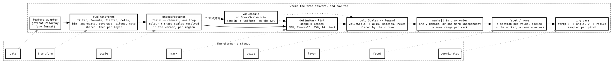

# The grammar, stage by stage

Every display's appearance settings speak one grammar of graphics: a few config
objects, spelt as Vega-Lite spells them, that every surface reads.
`LinearMarkDisplay` (`plugins/marks`) speaks all of it: its picture is
nothing but `marks`, `transform`, `encoding`, `facet` and `rows`. Every other
display keeps its own fetch, layout and domain actions and shares the parts,
so `encoding.color` on an alignments track and on a gene track is the same
object, resolved by the same function (ADRs [091](../architecture-decision-records/adr-091-a-displays-settings-are-a-declaration.md), [199](../architecture-decision-records/adr-199-the-maf-display-stays-its-own-and-shares-the-grammars-kernels.md), [238](../architecture-decision-records/adr-238-every-display-speaks-vega-lite.md)).

This doc walks the stages in pipeline order. For each it names the config
object, the code that reads it, what writes it, and the decisions in force.
Three docs sit beside it. [GRAMMAR_OF_GRAPHICS.md](GRAMMAR_OF_GRAPHICS.md)
holds the positions taken and the features declined: read it before proposing
a feature. [MARK_ENCODING.md](MARK_ENCODING.md) has the encoder's traps, and
[CONFIG_SPELLINGS.md](CONFIG_SPELLINGS.md) has every word and which displays
take it.

## One object per concept

The rule that organizes everything below: color, the value scale, the facet,
the rows and each transform step are one object each, and the painter, the
uniforms, the legend, the axis, the menus, "Edit plot...", the validator, the
agent API, a share link and SVG export all derive from it. A display that
spells a concept its own way is the finding, not a variant to document.

A display's grammar settings together are its **plot**, the slots its config
schema marks `plot` (ADR [204](../architecture-decision-records/adr-204-every-display-edits-its-grammar-settings-as-one-plot.md)). `BaseDisplay` reads it as `plot`, checks a
draft with `plotProblems` and writes one with `applyPlot`; `plotKeysOf`,
`plotOf` and `liftPlot` are in `packages/core/src/configuration/plot.ts`.
"Edit plot..." (`PlotDialog`, opened from `plotMenu.ts` in display-kit) edits
the same object as text, offering the display's `plotExamples`. A settings bag,
a share link, a session spec and a track edit write a channel object whole,
never member by member (ADRs [215](../architecture-decision-records/adr-215-rows-and-color-write-whole-on-every-display.md), [236](../architecture-decision-records/adr-236-a-track-edit-stores-a-channel-whole.md)).

## Data

An adapter answers features through `getFeaturesArray`, or a typed table
through `getFeatureTable` where it has one (MAF, BigWig), on
`BaseFeatureDataAdapter`. The grammar reads each record where the parser left
it, through a reader resolved once per region; the GPU instance buffer is the
one new representation (ADRs [191](../architecture-decision-records/adr-191-the-mark-pipeline-runs-over-tables.md), [193](../architecture-decision-records/adr-193-an-adapter-answers-the-mark-pipeline-its-typed-arrays.md)). The field lists a picker offers on the
mark display come from the `MarkScanPlotFields` RPC.

## Filter

`filter` is a list of Vega-Lite field predicates (`{ field, equal | oneOf |
gte | lte | valid ... }`), or a `jexl:` string as the slow path. The schema is
`fieldPredicateConfigSchema.ts` (display-kit), and `compilePredicates`
(`packages/core/src/util/fieldPredicate.ts`) compiles the list to typed reads
and compares before the loop. A predicate lives with what it selects:
`rows.filter` selects rows, `pileup.bases.filter` bases, and the alignments
`filter` reads and the junctions and connections derived from them
(ADRs [218](../architecture-decision-records/adr-218-the-read-filter-and-row-groups-are-typed-objects.md), [232](../architecture-decision-records/adr-232-a-predicate-lives-where-what-it-selects-lives.md), [238](../architecture-decision-records/adr-238-every-display-speaks-vega-lite.md)).

## Transform

`transform[]` (the display's, run before the facet) and `marks[].transform[]`
(each layer's) are lists of typed steps: `filter`, `formula`, `bin`,
`aggregate`, `window`, `coverage`, `flatten`, `cells`, `pileup` and `mate`.
The types are `TransformStep` in `packages/core/src/util/markEncodingTypes.ts`;
`runTransforms` in `packages/core/src/util/featureTransforms.ts` runs them in
the worker, shared on the request and then per layer, so a binned density and
the raw features share one fetch. Each step is one schema keyed by `type`, and
a step names the channel its output feeds (ADRs [112](../architecture-decision-records/adr-112-a-layer-owns-its-transform-and-its-zoom-range.md), [150](../architecture-decision-records/adr-150-a-transform-step-is-one-schema-per-type.md), [173](../architecture-decision-records/adr-173-a-step-names-the-channel-its-output-feeds.md), [197](../architecture-decision-records/adr-197-a-bin-cuts-an-interval-at-its-edges.md)). Transforms
are the mark display's; the other displays keep their hand-written pipelines,
MAF included (ADR [190](../architecture-decision-records/adr-190-the-maf-display-stays-off-the-feature-steps.md)). Adding a step touches five places that a test and the
compiler hold in agreement: GRAMMAR_OF_GRAPHICS.md §"Where a proposal lands".

## Scale: color

`encoding.color` is in one of three states (ADR [241](../architecture-decision-records/adr-241-a-color-object-is-unset-a-value-or-a-field.md)): unset (the display's
default, or the `impliedField` its schema declares), a constant `value` (a
bare CSS string is the shorthand), or a `field` read through a `scale` and
keyed by a `legend`. Scale types are `ordinal`, `threshold`, `linear`, `log`,
`symlog` and `identity`, each display declaring the ones it paints; the
members (`domain`, `range`, `scheme`, `domainMin`/`domainMid`/`domainMax`,
`domainQuantile`, `names`, `unknown`, `invalid`, `reverse`) and which display
takes which are CONFIG_SPELLINGS.md §"Where a shared path differs".

- **Schema**: one factory, `colorConfigSchema.ts` in display-kit
  (ADRs [131](../architecture-decision-records/adr-131-a-categorical-channel-is-one-config-object.md), [135](../architecture-decision-records/adr-135-the-color-objects-share-one-shape-and-a-preset-is-a-field.md), [151](../architecture-decision-records/adr-151-a-channels-scale-is-spelt-as-scales-y-spells-one.md)).
- **Resolution**: `colorEncodingOf` (display-kit) on every display
  (ADR [153](../architecture-decision-records/adr-153-every-display-resolves-its-color-through-one-function.md)), on the main thread, so a recolor refetches nothing
  (ADR [202](../architecture-decision-records/adr-202-every-mark-color-resolves-on-the-main-thread.md)). A categorical color is dealt once, on first sight, keeping the
  colors on screen apart (ADRs [205](../architecture-decision-records/adr-205-a-categorical-color-is-dealt-once-on-first-sight.md), [233](../architecture-decision-records/adr-233-a-categorical-deal-keeps-the-colors-on-screen-apart.md)); `identity` paints the colors a file
  carries (ADRs [166](../architecture-decision-records/adr-166-an-identity-scale-names-the-colors-a-file-carries.md), [243](../architecture-decision-records/adr-243-a-mark-paints-a-files-own-colors-through-an-identity-key.md)). Matrix displays read it through `MatrixRampMixin`.
- **Writes**: `ColorWritesMixin`'s `colorByField` and `setColorValue`, and
  `ParkedColorMixin`, which keeps a field's domain and names after a pick
  leaves it (ADRs [223](../architecture-decision-records/adr-223-a-color-object-takes-two-writes-and-applyplot.md), [241](../architecture-decision-records/adr-241-a-color-object-is-unset-a-value-or-a-field.md)). The menu rows are `colorByMenu.ts` (display-kit).

## Scale: value

`encoding.y` holds the plotted `field`, its `scale` (`type` of `linear`, `log`
or `symlog`, `domainMin`, `domainMax`, the fence and autoscale members), the
`axis` and fixed `rules`. A display has one y scale, which every drawing mark
folds into (ADRs [141](../architecture-decision-records/adr-141-one-y-scale-the-displays.md), [142](../architecture-decision-records/adr-142-one-value-scale-object.md), [151](../architecture-decision-records/adr-151-a-channels-scale-is-spelt-as-scales-y-spells-one.md)). The schema is `yChannelConfigSchema.ts` and the
model `ScoreScaleMixin`, both in wiggle-core; the `ScoreAxisMixin` it brings
declares `valueScales`, and the marks read the domain as a uniform
(`packages/render-core/src/marks/valueScale.ts`), so an autoscale never
touches a buffer (ADR [097](../architecture-decision-records/adr-097-the-y-channel-shares-its-scale-and-not-its-anchor.md)). The axis autoscales over what is loaded, an open
end follows one quantile, and the axis reaches 0 unless the scale says
otherwise (ADRs [124](../architecture-decision-records/adr-124-the-score-axis-autoscales-over-what-is-loaded.md), [179](../architecture-decision-records/adr-179-an-open-scale-end-follows-one-quantile.md), [182](../architecture-decision-records/adr-182-an-axis-reaches-0-unless-its-scale-says-otherwise.md)). The menu rows are `scoreMenuItems.ts`
(wiggle-core). The alignments coverage band spells the same object as
`coverage.encoding.y`.

## Encode

On the mark display the worker's `CoreGetEncodedLayers` RPC runs
`encodeFeatures` (`packages/core/src/util/markEncoding.ts`) once per region:
one loop that turns each field into a typed lane (`x`, `x2`, `y`, `row`,
`color`, `shape`, `size`, `text`), allocating only the lanes a mark asked for.
Generality resolves before the loop: a field name becomes a direct read, a
domain rides a uniform, and a shape composes its scale at `gen:shaders`
(ADR [095](../architecture-decision-records/adr-095-a-shape-composes-a-scale-at-compile-time.md)). The encoder's silent traps are MARK_ENCODING.md.

## Mark

The mark display's `marks[]` entries name a `mark` (`bar`, `point`, `rule`,
`line`, `rect`, `text` or `link`) and its `encoding` (ADR [159](../architecture-decision-records/adr-159-a-mark-is-spelt-as-vega-lite-spells-one.md)). A shape is
one hand-written shader, one packer, one Canvas2D painter (which is also the
SVG export) and one hit test, in `packages/render-core/src/marks/`;
`defineMark` declares one, and `createMarkBackend` derives the GPU and Canvas2D
backends from a display's mark list. Displays outside the mark display declare
mark lists too (ADR [106](../architecture-decision-records/adr-106-a-display-declares-its-marks.md)). The link and the line are marks (ADRs [163](../architecture-decision-records/adr-163-a-link-is-a-mark-and-the-arc-plugin-is-gone.md), [184](../architecture-decision-records/adr-184-a-line-is-a-mark.md));
sashimi arcs are links, and read connectors a connector mark (ADRs [222](../architecture-decision-records/adr-222-sashimi-arcs-are-link-marks.md), [225](../architecture-decision-records/adr-225-read-connectors-are-a-connector-mark.md)). Text is a DOM layer, emitted by
`FloatingText` and `SvgHaloText` (display-ui) and placed by each display
(ADR [162](../architecture-decision-records/adr-162-a-text-mark-is-a-dom-layer-placed-by-one-rule.md)).

## Guide

The legend derives from the color scales a display declares (`colorScales` on
`LegendMixin`), and the axis from its `valueScales`; `DisplayChrome` places
both on screen and the exporting view beside the plot (ADRs [108](../architecture-decision-records/adr-108-a-display-declares-its-color-scales.md), [109](../architecture-decision-records/adr-109-a-display-declares-its-value-scale.md), [136](../architecture-decision-records/adr-136-a-legend-follows-its-scale-and-a-color-slot-is-a-color.md)).
Hover and selection are a guide over the painting, not a condition on a
channel (ADR [110](../architecture-decision-records/adr-110-a-display-declares-what-is-highlighted.md)).

## Layer

`marks[]` is draw order. A layer owns its transform and its zoom range, so a
density summary and the raw features are two layers over one fetch
(ADRs [112](../architecture-decision-records/adr-112-a-layer-owns-its-transform-and-its-zoom-range.md), [117](../architecture-decision-records/adr-117-the-density-tier-is-a-mark-layer.md)). The multi-way synteny display's `laneLayers` give each lane a
layer list under its frame (ADR [180](../architecture-decision-records/adr-180-a-multiway-lane-is-a-layer-list-under-its-frame.md)).

## Facet

`facet` is `{ field, sort, hidden }`, plus `transform` on the mark display;
the schema is `facetConfigSchema.ts` (display-kit) (ADRs [130](../architecture-decision-records/adr-130-a-facet-is-the-displays-and-splits-before-each-layers-steps.md), [131](../architecture-decision-records/adr-131-a-categorical-channel-is-one-config-object.md)). A `sort`
orders sections and never decides which exist, so no worker request carries
one, and `groupKeyComparator` (`packages/core/src/util/groupKeys.ts`) is that
one rule for every facet, row order and legend. The mark display packs
sections in the worker (`facetLayers`); the feature, alignments and variant
displays group their own layouts by the same object. A facet on a row
attribute bands the rows instead (ADR [247](../architecture-decision-records/adr-247-a-facet-on-a-row-attribute-bands-the-rows.md)). Writes: `FacetWritesMixin`'s
`facetByField` and `HiddenGroupsMixin`'s `hideGroup` (ADR [237](../architecture-decision-records/adr-237-a-facet-takes-two-writes.md)); the menu rows
are `groupByMenu.ts` (display-kit).

## Rows

A row display's row axis is its `rows` object: the row `field`, `sort`,
`labels`, cluster `tree`, `color` and pinned `colors`, `step` (row height, a
pixel count or `"fit"`), `filter` and the sidebar `axis`
(ADRs [157](../architecture-decision-records/adr-157-a-row-displays-arrangement-is-the-rows-config-object.md), [160](../architecture-decision-records/adr-160-a-rows-color-is-one-categorical-channel-on-the-row-axis.md), [257](../architecture-decision-records/adr-257-the-row-axis-owns-its-settings.md)). The schema is `rowsConfigSchema.ts` (display-kit).
`TreeSidebarMixin` (`packages/tree-sidebar`) owns the arrangement: rows a
source lists keep its order past the `sort` list (`orderRowsByDomain`), a
tree rotates to it (`rotateNewickByDomain`), and clustering writes back into
`rows`. `RowHeightMixin` resolves `step`. A row's color resolves once and
deals in source order (ADRs [207](../architecture-decision-records/adr-207-a-rows-color-resolves-once-and-shows-beside-its-label.md), [239](../architecture-decision-records/adr-239-a-row-palette-deals-in-source-order.md)). The span mark reads rows through a row
table the vertex stage samples, so a reorder or hide uploads one small texture
(ADR [165](../architecture-decision-records/adr-165-the-row-axis-rides-a-table-the-vertex-stage-samples.md)). The menu row is `rowArrangementMenuItem.ts` (tree-sidebar).

## Coordinates

The linear genome view is the one linear coordinate. The circular view is a
coordinate stage over the linear displays, and a chord is a mark under the
circle's polar stage (ADRs [119](../architecture-decision-records/adr-119-the-circular-view-is-a-coordinate-stage-over-the-linear-displays.md), [177](../architecture-decision-records/adr-177-a-chord-is-a-mark-under-the-circles-polar-stage.md)).

## Checks

One checker per display, `configProblemsOf(conf)`, answers both "Edit plot..."
and the chip in the display's corner. The base runs `schemaPlotProblems`, the
schema's own `fieldPresets` rules, which is also what `jbrowse validate` runs
offline; a display adds its own rules, and the mark display replaces the base
with its rule list (`markProblems.ts`). `liveNotices` adds what only loaded
data can say. Details: GRAMMAR_OF_GRAPHICS.md §"Gaps against the grammar".
