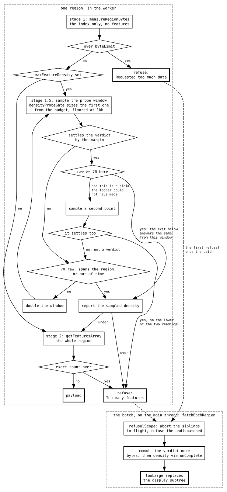

# The region-too-large gate

A gated display's worker asks the adapter's index for a region's byte size
before downloading. Over budget refuses and shows the "region too large"
banner; canvas adds a feature-density axis on the same banner. Force-load turns
both off for the track.

## How the verdict is built

**Neither budget is an RPC cache key.** `resolvedByteLimit()` and the feature display's
`maxFeatureDensity` travel as call-site arguments, never in `rpcProps()`, where
a swing at 20 kb or on force-load would be a full refetch. Raising a budget
refetches the refused region; lowering one re-banners from the stored
measurement with no RPC.

**The first refusal ends the batch and leaves the fetch running to its end.**
`refusalScope` aborts the siblings on a signal of the fan-out's own and stops
waiting for them, so the fetch ends the ordinary way with the verdict and its
viewport stamp already committed, and the plan's next run declines on them.
A linear display issues no separate estimate RPC. `CoreGetRegionByteEstimate` serves the track
export, `jb.getFeatures`, and the circle's chord variant display, whose
`CoreGetFeatures` takes no budget (`installChordFetch`).

## Measurement follows the viewport

The verdict is the last measurement, and the fetch always takes the next one.
Ungated, every fetch measures before it downloads. Gated, the fetch skeletons
skip only on `gateSkipsMeasuredViewport` — the banner is up *and* the
measurement already describes the viewport on screen — so a blocked display
runs one fetch per settled viewport that stops at the gate. Skipping
unconditionally freezes the estimate; never skipping spins on the
`fetchGeneration` bump.

**The density budget counts top-level features per pixel.**
`LinearBasicDisplay` defaults to 10, so a whole bacterial genome draws (E. coli
K-12's 4,751 top-level features over 4.6 Mb are 3.2/px at 1,500 px); the
variant display's records band keeps 1 (ADR-037). At 10, human RefSeq GFF3 at
whole-chromosome zoom passes the density axis (table below) and only the byte
gate refuses it: chr1 is 5.5 MB by the index, over `fetchSizeLimit`'s 5 MB,
while chr10 and chr17 are 2.8 MB and draw.

`calculateFeatureDensityStats` (`stats.ts`) grows a window from a point 25% into
the region. `densityProbeGate` can stop it once an *admitted* count reads
`DENSITY_SETTLE_MARGIN` times over budget; growth still tests the raw count, so
a filtered view is not refused on a population it filters away. A budget that
cannot size a window (`0`, NaN from jexl) yields no gate. One window is one draw
from a clumpy distribution:

<!-- BEGIN GENERATED MEASUREMENT density-probe-sample-point -->

_Generated by `pnpm autogen` — edit the source, not this block._

| chromosome / zoom      | truth (feat/px) | at the 25% point | min / median / max over offsets | offsets settling |
| ---------------------- | --------------- | ---------------- | ------------------------------- | ---------------- |
| chr1 whole-genome      | 103.4           | 95.5             | 0.5 / 96.0 / 203.5              | **18/19**        |
| chr10 whole-genome     | 94.4            | 78.5             | 33.0 / 90.5 / 150.0             | **19/19**        |
| chr17 whole-genome     | 166.6           | 157.5            | 46.0 / 159.0 / 299.0            | **19/19**        |
| chr1 whole-chromosome  | 8.3             | 10.5             | 0.5 / 7.5 / 17.0                | 15/19            |
| chr10 whole-chromosome | 4.1             | 2.5              | 1.0 / 4.0 / 13.5                | 9/19             |
| chr17 whole-chromosome | 4.5             | 9.5              | 0.5 / 4.5 / 27.5                | 12/19            |

<!-- END GENERATED MEASUREMENT density-probe-sample-point -->

The settling column is at a budget of 1. At `LinearBasicDisplay`'s 10 a window
settles only past 40/px, which no whole-chromosome row reaches, so those fall
through to the ladder and the exact count.

## The sub-floor budget tier

Below `AUTO_FORCE_LOAD_BP` the byte budget is multiplied by
`SUB_FLOOR_BYTE_BUDGET_FACTOR`. An off-switch would be bypassable, since a
region over budget below the floor was over budget at the floor too; but the
estimate stops moving below a BAI's 16 kb bins, so the banner's advice is
unactionable:

<!-- BEGIN GENERATED MEASUREMENT subfloor-index-bin-bytes -->

_Generated by `pnpm autogen` — edit the source, not this block._

| file                      | 1kb–10kb (flat) | 20kb   |
| ------------------------- | --------------- | ------ |
| volvox-ultradeep (~2000x) | **7442k**       | 14468k |
| volvox-sorted             | 257k            | 317k   |
| volvox long reads         | 102k            | 102k   |

<!-- END GENERATED MEASUREMENT subfloor-index-bin-bytes -->

**A deep BAM over a small genome stays bannered at every zoom with a BAI.**
Over SARS-CoV-2 (29,903 bp) the flat sub-floor value sits above the doubled
budget at both depths measured. A CSI built with `samtools index -c -m 10` and a
CRAM keep shrinking with the window, so zooming clears the banner on them. The
display's own estimate per window, bold where the banner showed; every window
but the whole genome is under the 20 kb floor and has a 10 MB budget:

<!-- BEGIN GENERATED MEASUREMENT amplicon-depth-gate -->

_Generated by `pnpm autogen` — edit the source, not this block._

| file              | mean depth | whole genome (5 MB budget) | 10 kb        | 2 kb         | 500 bp       | 100 bp       |
| ----------------- | ---------- | -------------------------- | ------------ | ------------ | ------------ | ------------ |
| BAM + BAI         | 5,000x     | **22.2 MB**                | **22.2 MB**  | **12.2 MB**  | **12.2 MB**  | **12.2 MB**  |
| BAM + CSI `-m 10` | 5,000x     | **22.4 MB**                | **13.9 MB**  | 4.0 MB       | 1.7 MB       | 0.9 MB       |
| CRAM + CRAI       | 5,000x     | **11.1 MB**                | 6.8 MB       | 1.7 MB       | 0.5 MB       | 0.2 MB       |
| BAM + BAI         | 50,000x    | **204.7 MB**               | **204.7 MB** | **112.4 MB** | **112.4 MB** | **112.4 MB** |
| BAM + CSI `-m 10` | 50,000x    | **208.1 MB**               | **129.4 MB** | **37.0 MB**  | **15.1 MB**  | 7.9 MB       |
| CRAM + CRAI       | 50,000x    | **108.4 MB**               | **65.6 MB**  | **15.7 MB**  | 3.9 MB       | 1.3 MB       |

<!-- END GENERATED MEASUREMENT amplicon-depth-gate -->

Force-load drew every 5,000x run. At 50,000x a whole-genome load takes about
20 s with about 3 GB of worker heap, and one of six CRAM runs lost its
renderer; at 2 kb every 50,000x run drew. The first paint is timed from the
force-load. ada's headless Chrome renders in software, so the times are the
worker's plus SwiftShader's, not a GPU's:

<!-- BEGIN GENERATED MEASUREMENT amplicon-depth-force-load -->

_Generated by `pnpm autogen` — edit the source, not this block._

| file      | depth   | window       | first paint, median | range         | peak worker heap | peak renderer | drawn   |
| --------- | ------- | ------------ | ------------------- | ------------- | ---------------- | ------------- | ------- |
| BAM + BAI | 5,000x  | whole genome | 2235ms              | 2198–2427ms   | 321 MB           | 1053 MB       | 3/3     |
| BAM + CSI | 5,000x  | whole genome | 2095ms              | 2026–2120ms   | 308 MB           | 1205 MB       | 3/3     |
| CRAM      | 5,000x  | whole genome | 1933ms              | 1831–2113ms   | 314 MB           | 1244 MB       | 3/3     |
| BAM + BAI | 50,000x | whole genome | 21823ms             | 21740–22459ms | 2912 MB          | 8672 MB       | 3/3     |
| BAM + CSI | 50,000x | whole genome | 19179ms             | 18485–19275ms | 2879 MB          | 8779 MB       | 3/3     |
| CRAM      | 50,000x | whole genome | 17913ms             | 17905–17920ms | 3088 MB          | 8354 MB       | **2/3** |
| BAM + BAI | 5,000x  | 2 kb         | 863ms               | 853–972ms     | 86 MB            | 597 MB        | 3/3     |
| BAM + BAI | 50,000x | 2 kb         | 4850ms              | 4640–4909ms   | 884 MB           | 3572 MB       | 3/3     |
| BAM + CSI | 50,000x | 2 kb         | 2916ms              | 2841–2977ms   | 479 MB           | 1780 MB       | 3/3     |
| CRAM      | 50,000x | 2 kb         | 2620ms              | 2550–2738ms   | 526 MB           | 1670 MB       | 3/3     |

<!-- END GENERATED MEASUREMENT amplicon-depth-force-load -->

**Raising `fetchSizeLimit` on the track's adapter to 60 MB draws a 5,000x file
at every zoom and a 50,000x file from 2 kb in.** The whole-genome 50,000x load,
the 20 s and 3 GB row above, stays behind the banner, and so does the 10 kb
window on a BAM. Time is from navigation to ready:

<!-- BEGIN GENERATED MEASUREMENT amplicon-depth-raised-limit -->

_Generated by `pnpm autogen` — edit the source, not this block._

| file              | mean depth | whole genome | 10 kb        | 2 kb         | 500 bp       |
| ----------------- | ---------- | ------------ | ------------ | ------------ | ------------ |
| BAM + BAI         | 5,000x     | draws, 2.1 s | draws, 1.6 s | draws, 0.9 s | draws, 0.8 s |
| CRAM + CRAI       | 5,000x     | draws, 1.9 s | draws, 1.4 s | draws, 0.8 s | draws, 0.6 s |
| BAM + BAI         | 50,000x    | **banner**   | **banner**   | draws, 4.4 s | draws, 3.1 s |
| BAM + CSI `-m 10` | 50,000x    | **banner**   | **banner**   | draws, 2.8 s | draws, 1.4 s |
| CRAM + CRAI       | 50,000x    | **banner**   | draws, 8.9 s | draws, 2.4 s | draws, 1.1 s |

<!-- END GENERATED MEASUREMENT amplicon-depth-raised-limit -->

**Alignments keep the doubled budget; a wider one and an off-switch were both
tried on 2026-11-22 and declined.** Index bytes do not rank loads across index
kinds: the 50,000x BAM's 2 kb window estimates 112.4 MB and drew in 4.9 s on
0.9 GB of worker heap, while the same depth's CRAM estimates 108.4 MB for the
whole genome, the 18 s and 3 GB row that lost a renderer in one run of six. No
single budget applied to both windows alike passes the first and stops the
second.

- **A fetch reads the screen plus half a screen each side**, so a view just
  under 20 kb fetches about 40 kb, the whole of a 30 kb genome. With no budget
  under the floor, one zoom-in from the whole-genome banner loaded it unasked;
  with a 120 MB one, a factor of 24 over the alignments adapters' 5 MB
  `fetchSizeLimit` default, the CRAM's 108.4 MB did the same.
- **With no budget nothing is measured**, so the stored estimate goes stale
  under the floor and re-banners on zoom-out for a place the view has left.
- **A factor multiplies a raised limit too**: that factor of 24 over this
  section's 60 MB is 1.44 GB.
- **A wider budget makes the banner's zoom advice wrong the other way**: two
  flat measurements above the floor drop "Zoom in to see features" while a
  view under it would load.

## A budget has a scope

`gateByteLimit` is what one **region** may cost, so a region set reduces by max
(`measureRegionBytes` worker-side, `commitFetchBytes` main-side) and a view
where every region fits is never refused for their sum.
`CoreGetRegionByteEstimate` takes a required `scope`: the save dialog asks
`wholeRequest`, because a save is one download, and so does the chord variant
display, because the circle holds every region's records at once.

<!-- BEGIN GENERATED MEASUREMENT byte-estimate-scope -->

_Generated by `pnpm autogen` — edit the source, not this block._

| regions | `wholeRequest` bytes | `largestRegion` bytes | whole/largest | per-region cost |
| ------- | -------------------- | --------------------- | ------------- | --------------- |
| 24      | 3969k                | 381k                  | 10.43x        | 1.00x           |
| 70      | **5059k**            | **968k**              | 5.23x         | 0.90x           |

<!-- END GENERATED MEASUREMENT byte-estimate-scope -->

## Shared primitives

**Hooks a display may override.** `gateEnabled` (a literal, checked by
`check-gated-adapter-budgets`); `densityTooLarge`; `byteGateAdapterPath`;
`byteGateAdapterConfig`. `FeatureGateMixin` composes after
`MultiRegionDisplayMixin()`; `no-restricted-syntax` fails the other order, whose
cost is a silently off gate.

**The budget.** `resolveByteLimit` prefers the adapter's declared
`fetchSizeLimit` at `byteGateAdapterPath` over the display's slot and doubles it
below the floor. Consumers read `resolvedByteLimit()`.

<!-- BEGIN GENERATED GATED_BUDGETS -->

_Generated by `pnpm autogen` — edit the source, not this block._

<!-- prettier-ignore -->
| tier | value | applies to |
| --- | --- | --- |
| adapter slot | 5 Mb | `BamAdapter`, `CramAdapter`, `SplitVcfTabixAdapter`, `VcfTabixAdapter` — whatever display they are under |
| display slot | 5 Mb | `LinearBasicDisplay` — every inheriting adapter under this display |
| display slot | 5 Mb | `LinearMultiRowFeatureDisplay` — every inheriting adapter under this display |
| display slot | 5 Mb | `LinearMafDisplay` — every MAF adapter, none of which declares its own, so this is the whole budget |
| display slot | 20 Mb | `LDTrackDisplay` — PlinkLDTabixAdapter, which declares none, so this is the whole budget |
| display slot | 10 Mb | `GCContentTrack` — GCContentAdapter under the GC track's LinearWiggleDisplay, a byte per base scanned |
| display slot | 1 Mb | `baseLinearDisplayConfigSchema` — every inheriting adapter under every other display |

Adapters with no `fetchSizeLimit` of their own, which therefore take whichever display row applies: `BedTabixAdapter`, `BgzipMafAdapter`, `BgzipTaffyAdapter`, `BigBedAdapter`, `BigMafAdapter`, `CrisprGuideAdapter`, `GCContentAdapter`, `GWASAdapter`, `Gff3TabixAdapter`, `GtfTabixAdapter`, `HtsgetBamAdapter`, `MafTabixAdapter`, `MotifListAdapter`, `MultiWiggleAdapter`, `PlinkLDAdapter`, `SequenceSearchAdapter`.

<!-- END GENERATED GATED_BUDGETS -->

**The byte axis has no floor.** Where the estimate goes flat is a property of the file:

<!-- BEGIN GENERATED MEASUREMENT index-estimate-flat-spans -->

_Generated by `pnpm autogen` — edit the source, not this block._

| file                                                    | flat from        | value |
| ------------------------------------------------------- | ---------------- | ----- |
| `volvox/volvox.maf.bed.gz`                              | 25kb up to 100kb | 307k  |
| `volvox/volvox.maf.bed.gz`                              | 12.5kb down      | 213k  |
| `breakpoint/hs37d5.HG002-SequelII-CCS.sv.vcf.gz` (chr1) | **7.8 Mb down**  | 15k   |
| `ce11.26way.chrI_subset.bed.gz`                         | 200bp to 50kb    | 93k   |

<!-- END GENERATED MEASUREMENT index-estimate-flat-spans -->

