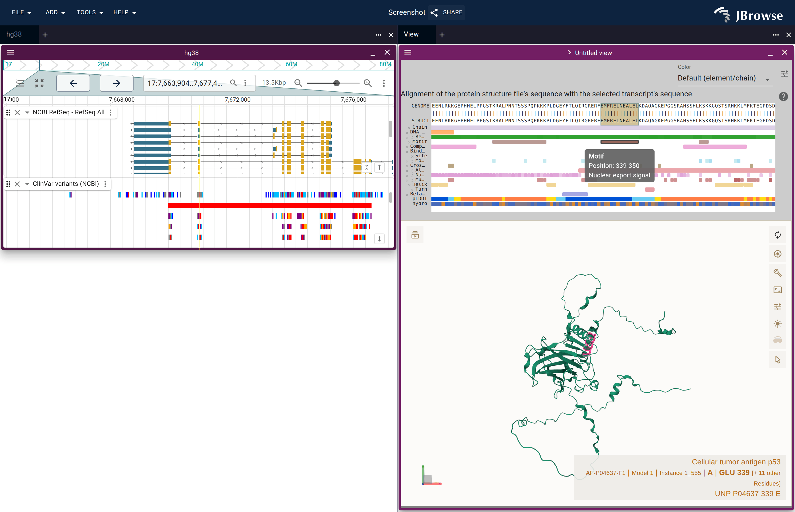
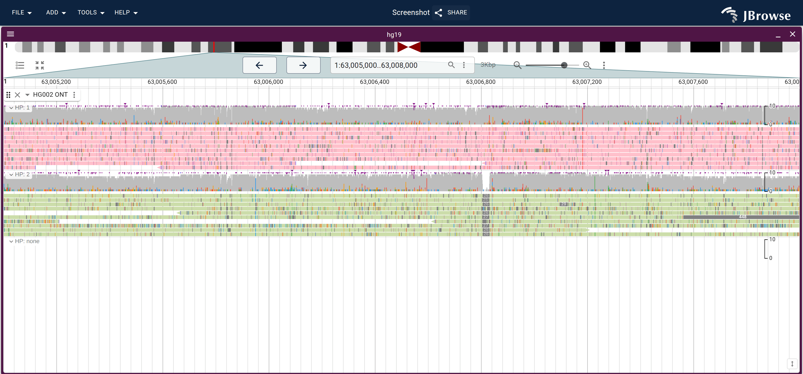
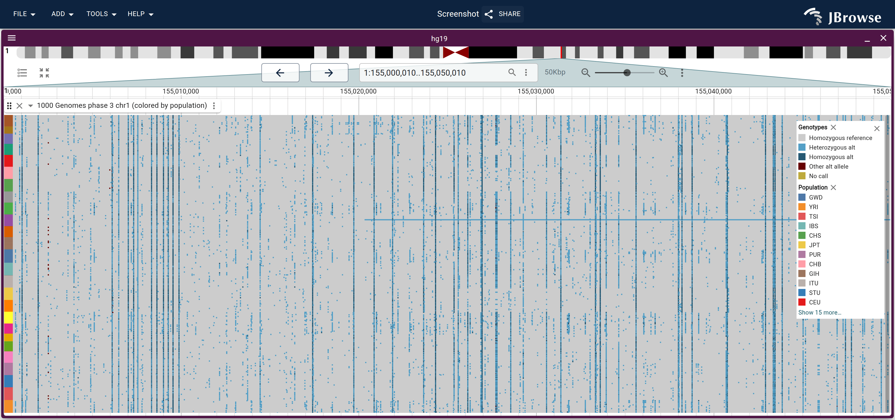
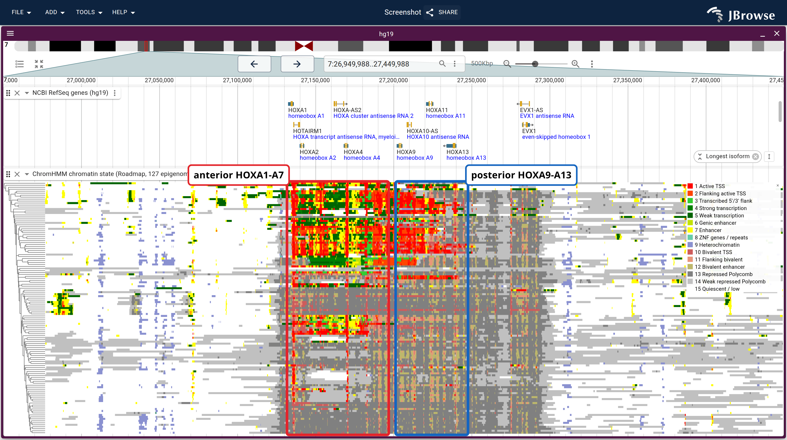

Hello all!

I am pleased to announce JBrowse 2 v5.0.0, six months in the making. The major
outcome of v5.0.0 is the introduction of GPU powered rendering. This effort has
significantly improved the performance and smoothness of simple things like
zooming in on the app. We invested a ton of effort making this as high quality
as possible.

The
[optimization guide](https://jbrowse.org/jb2/docs/developer_guides/optimizations)
covers some of the performance work we did.

Opening the app is faster too. Here is a cold load of a BAM track, timed from a
fresh browser until the track has drawn, across releases since v2:

But notably, we made innumerable changes during this release cycle, amounting to
almost a complete rewrite of the codebase. Here is a visualization of these code
changes

Despite all this enormous change, the app still retains the look and feel, and
your v4 sessions and share links carry over. Most config.json files load too:
run `jbrowse validate` on yours, and it names any key v5 no longer reads.

Here are some more highlights in this release

## New tutorials

The docs are rebuilt around tutorials, each on real public data and a practical
bioinformatics workflow:
[cancer SVs](https://jbrowse.org/jb2/docs/tutorials/cancer_sv),
[pangenome graphs](https://jbrowse.org/jb2/docs/tutorials/pangenome_hprc),
[ChromHMM](https://jbrowse.org/jb2/docs/tutorials/chromhmm),
[single-cell pseudobulk](https://jbrowse.org/jb2/docs/tutorials/scrna_pseudobulk),
[QTL mapping](https://jbrowse.org/jb2/docs/tutorials/bxd_qtl) and many more
across synteny, population genomics, epigenomics and transcriptomics. The
[tutorial index](https://jbrowse.org/jb2/docs/tutorials/) lists them all, and is
the best place to start.

Every screenshot is generated from the steps its tutorial lists, so it does not
go out of date, and many tutorials carry a generated video as well. Under each
figure, the **Open or rebuild this view** button shows how to reach the same
result by point and click or from config.

Now, on to what that rewrite made room for.

## Highlights

### Alignments

Group and color reads by haplotype, methylation or structural variant signal,
and call a
[consensus sequence](https://jbrowse.org/jb2/docs/user_guides/consensus_sequence)
from the reads to FASTA or VCF. See the
[haplotype](https://jbrowse.org/jb2/docs/tutorials/hg002_haplotypes) and
[methylation](https://jbrowse.org/jb2/docs/tutorials/methylation) tutorials, and
the
[alignments guide](https://jbrowse.org/jb2/docs/user_guides/alignments_track).

### Multi-sample variants

Color by predicted consequence, SV type or copy-number state, group rows by
sample metadata, and draw phased data as haplotypes. See the
[1000 Genomes SV](https://jbrowse.org/jb2/docs/tutorials/sv_multisamples) and
[TCGA cohort](https://jbrowse.org/jb2/docs/tutorials/tcga_cohort_mutations)
tutorials.

### Multi-row feature tracks

Hundreds of rows in one track, for chromosome painting, local ancestry or
ChromHMM states, with a categorical legend and
[clustering](https://jbrowse.org/jb2/docs/user_guides/clustering) that reorders
rows by similarity. See the
[ChromHMM](https://jbrowse.org/jb2/docs/tutorials/chromhmm) tutorial and the
[multi-row guide](https://jbrowse.org/jb2/docs/user_guides/multirow_feature_track).

### A grammar of graphics (experimental)

Declare a mark (bar, point, line, rule, span, text or link) and the fields that
feed it, and the axis, legend, hover and SVG export follow. A BED column becomes
a bar chart and a BAM's insert sizes a scatter over its own coverage. Simple
plots come from **Edit plot...** on the track menu. See the
[mark display guide](https://jbrowse.org/jb2/docs/config_guides/mark_display)
and the [Alu age](https://jbrowse.org/jb2/docs/tutorials/alu_age) and
[insert size](https://jbrowse.org/jb2/docs/tutorials/read_marks) tutorials.

### JBrowse in R

[`@jbrowse/tables`](https://www.npmjs.com/package/@jbrowse/tables) returns what
a JBrowse display draws as columnar tables, already colored as the browser
colors them. [ggjbrowse](https://github.com/GMOD/ggjbrowse) turns them into data
frames with `geom_jbrowse_*` layers, so a JBrowse figure is ordinary ggplot2.

### More in v5

- **[Structural variants](https://jbrowse.org/jb2/docs/user_guides/sv_visualization):**
  a breakend right-click opens the split view, and a chain of breakends walks
  through one panel per stop. See the
  [cancer rearrangement](https://jbrowse.org/jb2/docs/tutorials/cancer_sv)
  tutorial.
- **[Synteny](https://jbrowse.org/jb2/docs/user_guides/linear_synteny_view):**
  multi-genome comparisons from
  [all-vs-all PAF](https://jbrowse.org/jb2/docs/tutorials/allvsall_synteny) or
  [jcvi `.blocks`](https://jbrowse.org/jb2/docs/tutorials/multiway_synteny_grape_peach_cacao),
  colored by [dN/dS](https://jbrowse.org/jb2/docs/tutorials/selection_pressure)
  or
  [SyRI rearrangement type](https://jbrowse.org/jb2/docs/tutorials/syri_synteny).
- **[MAF](https://jbrowse.org/jb2/docs/user_guides/maf_track) is built in**, and
  a beta
  [graph genome view](https://jbrowse.org/jb2/docs/user_guides/graph_genome_view)
  draws a pangenome graph. See the
  [HPRC](https://jbrowse.org/jb2/docs/tutorials/pangenome_hprc) tutorial.
- **[Quantitative tracks](https://jbrowse.org/jb2/docs/user_guides/quantitative_track)**
  gain scatter, line and symlog scales, and clip extreme outliers by default.
- **New [`GWAS` plugin](https://jbrowse.org/jb2/docs/user_guides/gwas_track):**
  LocusZoom-style Manhattan plots colored by LD. See the
  [LD](https://jbrowse.org/jb2/docs/tutorials/ld_mosquitoes) tutorial.
- **[Gene tracks](https://jbrowse.org/jb2/docs/user_guides/gene_track)**
  collapse a gene to one representative transcript when zoomed out, and
  translate alternative genetic codes correctly.
- **Sequence tools:** in Desktop,
  [BLAT and in-silico PCR](https://jbrowse.org/jb2/docs/user_guides/blat), and
  [sequence search](https://jbrowse.org/jb2/docs/user_guides/sequence_search)
  with CRISPR guide and motif-list modes.
- **Everyday use:** the theme can follow your system, touch screens pan and
  pinch to zoom, widgets open full-screen on a phone, and a UCSC hub is
  searchable by its tracks' declared names. Edited
  [track settings](https://jbrowse.org/jb2/docs/tutorials/display_settings)
  travel with a shared session.
- **[Desktop](https://jbrowse.org/jb2/docs/quickstart_desktop)** opens a genome
  by drag and drop, opens a `config.json` by URL, and opens a Web share link.
- **[Embedded components](https://jbrowse.org/jb2/docs/embedded_components)**
  have a prop-driven interface, a framework-agnostic mount API and a
  [build-your-own examples site](https://jbrowse.org/jb2/docs/tutorials/embed_linear_genome_view).
  The [Python](https://jbrowse.org/jb2/docs/jbrowse_anywidget) and
  [JBrowseR](https://jbrowse.org/jb2/docs/jbrowser) notebook integrations build
  on them.
- **[AI agents](https://jbrowse.org/jb2/docs/agents):** JBrowse Desktop runs an
  MCP server, so Claude Desktop or Claude Code can open a genome, add a track
  and screenshot the app you already have open. An agent runs JavaScript against
  your live session, so read what your client asks you to approve;
  `JBROWSE_DISABLE_MCP=1` removes the endpoint.
- **[CLI](https://jbrowse.org/jb2/docs/cli):** `jbrowse validate` checks a
  config before you ship it,
  [`@jbrowse/img`](https://jbrowse.org/jb2/docs/jbrowse-img) exports synteny and
  split views as SVG, and
  [`@jbrowse/capture`](https://jbrowse.org/jb2/docs/jbrowse-capture) screenshots
  a live JBrowse once it has finished rendering.

...and that is just a short overview. The more complete set of features added in
v5.0.0, grouped by area, is in the
[complete list of changes](#changes-since-v430) at the bottom of this post.

## Breaking changes

Most v4 sessions and share links open unchanged, and most website admins can
update without touching their config.json.

The preferred syntax of config.json has changed in many ways. Most old keys
migrate when the config loads, and `jbrowse validate` names the ones that do
not. See https://jbrowse.org/jb2/docs/cookbook/ for examples and usages of the
new config concepts, in many cases, the configuration is greatly simplified.

<!-- name-ok: LinearLollipopDisplay -->

A few types were removed outright. The `lollipop` plugin is gone, so a
`LinearLollipopDisplay` is dropped with a warning and its track opens on its
default display. The `arc` plugin is gone too: its displays migrate to the mark
display, where an arc is a `link` mark. Plugins in the CommonJS format
(`cjsUrl`) no longer load, so point them at `umdUrl` or `esmUrl`. These and the
other user-visible removals are listed under
[What was removed](#what-was-removed) at the bottom of this post.

For developers of plugins, there are significant changes that have occurred that
may cause breakages. See
[v5 upgrade guide](https://jbrowse.org/jb2/docs/developer_guides/upgrading_v5)

<!-- name-ok: pluggableElement -->

One of them is worth calling out here: most view and display state models now
load lazily. Reading `pluggableElement.stateModel` before its model has loaded
throws an error naming the loader to await. The v4 idiom still works inside
`Core-extendPluggableElement`, which fires once the loader resolves, but
`extendStateModel` is the one call that covers every case, and the guide has the
before and after.

If you hit any issues or need help migrating your plugins and configs, open an
issue on [GitHub](https://github.com/GMOD/jbrowse-components/issues) or write to
jbrowse2@berkeley.edu.

Thanks to everyone, and happy browsing!
