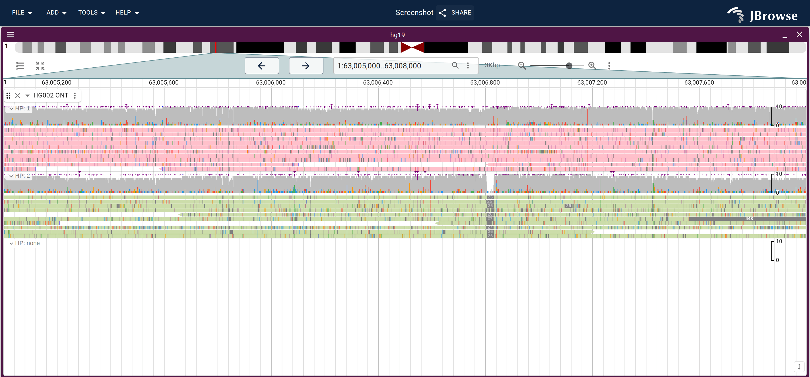
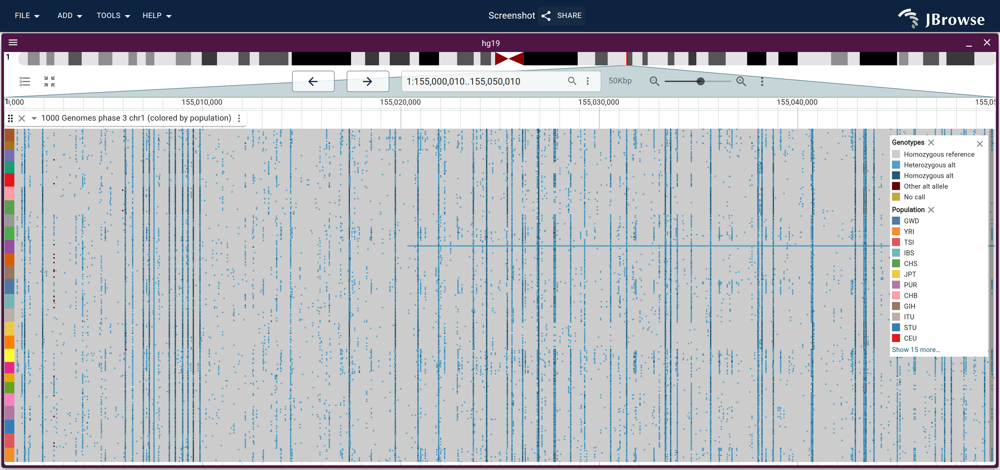

Hello all!

I am pleased to announce JBrowse 2 v5.0.0, six months in the making. The major
outcome of v5.0.0 is the introduction of GPU powered rendering. This effort has
significantly improved the performance and smoothness of simple things like
zooming in on the app. We invested a ton of effort making this as high quality
as possible.

The
[optimization guide](https://jbrowse.org/jb2/docs/developer_guides/optimizations)
covers some of the performance work we did.

Opening the app is faster too. Here is a cold load of a BAM track, timed from a
fresh browser until the track has drawn, across releases since v2:

But notably, we made innumerable changes during this release cycle, amounting to
almost a complete rewrite of the codebase. Here is a visualization of these code
changes:

Despite all this enormous change, the app still retains the look and feel, and
your v4 sessions and share links carry over. Most config.json files load too:
run `jbrowse validate` on yours, and it names any key v5 no longer reads.

The docs are rebuilt around
[tutorials](https://jbrowse.org/jb2/docs/tutorials/), each a practical workflow
on real public data, from cancer SVs to pangenomes to single-cell pseudobulk.
Every screenshot is generated from the steps its tutorial lists, so it stays
current.

## Highlights

### One grammar of graphics across tracks

Track settings are spelt one way across track types, as Vega-Lite spells them:
**Color by** writes a color scale (`encoding.color`) on reads, genes and
variants alike, **Group by** writes a facet, and a row display's order and
labels are its `rows`. The experimental
[mark display](https://jbrowse.org/jb2/docs/config_guides/mark_display) builds a
plot from marks (bar, point, line, rule, rect, text, link) over any field, so a
BED column becomes a bar chart or a BAM's insert sizes a scatter. See
[settings every track shares](https://jbrowse.org/jb2/docs/config_guides/grammar)
and the [insert size](https://jbrowse.org/jb2/docs/tutorials/read_marks)
tutorial.

### Multi-way synteny

The
[multi-way synteny display](https://jbrowse.org/jb2/docs/user_guides/multiway_synteny_display)
stacks several genomes under a linear genome view, one lane per genome drawn in
that genome's coordinates, with ribbons joining the matching stretches or genes.
It reads pairwise alignments against one genome, a PAF holding many pairs, an
ortholog table such as a jcvi `.blocks` file, or haplotype walks through a
pangenome graph. See the
[OrthoFinder](https://jbrowse.org/jb2/docs/tutorials/orthofinder_synteny) and
[grape, peach and cacao](https://jbrowse.org/jb2/docs/tutorials/multiway_synteny_grape_peach_cacao)
tutorials.

### Alignments

Group reads by haplotype or structural variant signal, color them by
methylation, and call a
[consensus sequence](https://jbrowse.org/jb2/docs/user_guides/consensus_sequence)
from them. See the
[haplotype](https://jbrowse.org/jb2/docs/tutorials/hg002_haplotypes) and
[methylation](https://jbrowse.org/jb2/docs/tutorials/methylation) tutorials.

### Multi-sample variants

Color variants by predicted consequence or SV type, group samples by their
metadata, and draw phased data as haplotypes. See the
[1000 Genomes SV](https://jbrowse.org/jb2/docs/tutorials/sv_multisamples)
tutorial.

### Variants on protein structures

The protein view opens a gene's AlphaFold or PDB structure beside its exons,
each residue mapped to its codon, so a variant leads from the genome to the
residue it changes. See the
[sickle cell](https://jbrowse.org/jb2/docs/tutorials/protein_variants_sickle_cell)
tutorial.

### JBrowse in R

[`@jbrowse/tables`](https://www.npmjs.com/package/@jbrowse/tables) returns what
a JBrowse display draws as tables, and
[ggjbrowse](https://github.com/GMOD/ggjbrowse), early work in progress, turns
them into `geom_jbrowse_*` layers, so a JBrowse figure is ordinary ggplot2. The
linear genome view's image export also
[writes an R script](https://jbrowse.org/jb2/docs/user_guides/r_export) that
redraws the open tracks.

### Also new

- **[Structural variants](https://jbrowse.org/jb2/docs/user_guides/sv_visualization):**
  right-click a breakend to open the split view, which follows a chain of
  breakends with one panel per locus.
- **[Multi-row feature tracks](https://jbrowse.org/jb2/docs/user_guides/multirow_feature_track):**
  hundreds of rows in one track, for ChromHMM states or local ancestry, with
  [clustering](https://jbrowse.org/jb2/docs/user_guides/clustering) to reorder
  them by similarity.
- **[GWAS](https://jbrowse.org/jb2/docs/user_guides/gwas_track):** a new plugin
  draws LocusZoom-style Manhattan plots colored by LD.
- **[BLAT and in-silico PCR](https://jbrowse.org/jb2/docs/user_guides/blat)** on
  every [genomes.jbrowse.org](https://genomes.jbrowse.org) genome.
- **[Track selector](https://jbrowse.org/jb2/docs/user_guides/basic_usage#track-table):**
  a table of tracks with filter chips over their metadata.
- **[AI agents](https://jbrowse.org/jb2/docs/agents):** JBrowse Desktop runs an
  MCP server, so Claude Code or Claude Desktop can drive the app you have open.
  An agent runs JavaScript against your live session, so read what your client
  asks you to approve; `JBROWSE_DISABLE_MCP=1` turns it off.
- **[Embedding](https://jbrowse.org/jb2/docs/embedded_components):** a
  prop-driven interface and a framework-agnostic mount API, with
  [Python](https://jbrowse.org/jb2/docs/jbrowse_anywidget) and
  [R](https://jbrowse.org/jb2/docs/jbrowser) notebook integrations.

Everything else, grouped by area, is in the
[complete list of changes](#changes-since-v430) at the bottom of this post.

## Breaking changes

Most v4 sessions and share links open unchanged, and most config.json files
load: old keys migrate when the config loads, and `jbrowse validate` names the
ones that do not. The [cookbook](https://jbrowse.org/jb2/docs/cookbook/) shows
the new config concepts, which are often much simpler.

<!-- name-ok: LinearLollipopDisplay -->
<!-- name-ok: sharedBookmarks -->

The `lollipop` plugin is gone, so a `LinearLollipopDisplay` is dropped and its
track opens on its default display. The `arc` plugin's displays migrate to the
mark display. The Desktop-only `cjsUrl` plugin format is gone; use `umdUrl` or
`esmUrl`. Highlights replace bookmarks, and v4's stored bookmarks and the
`sharedBookmarks` in a v4 share link are not read, so export them as BED from v4
and import that file. The rest is under [What was removed](#what-was-removed).

<!-- name-ok: pluggableElement -->

Plugin developers should read the
[v5 upgrade guide](https://jbrowse.org/jb2/docs/developer_guides/upgrading_v5).
Most view and display state models now load lazily, so reading
`pluggableElement.stateModel` before its model has loaded throws an error naming
the loader to await; `extendStateModel` works in every case.

If you hit any issues or need help migrating your plugins and configs, open an
issue on [GitHub](https://github.com/GMOD/jbrowse-components/issues) or write to
jbrowse2@berkeley.edu.

Thanks to everyone, and happy browsing!
